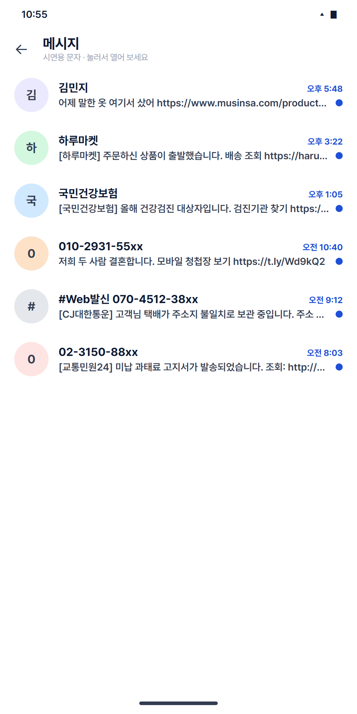
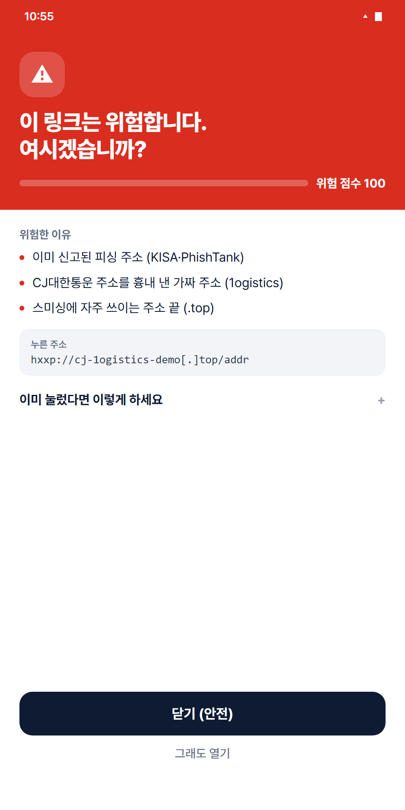
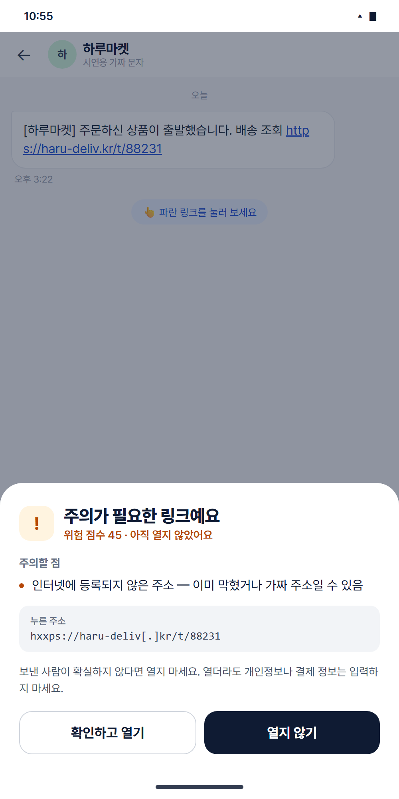
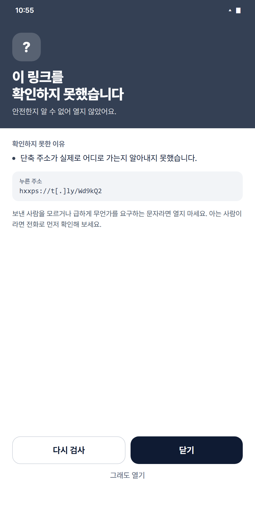
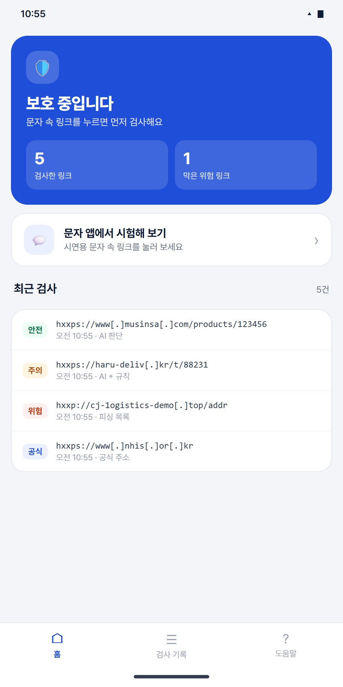
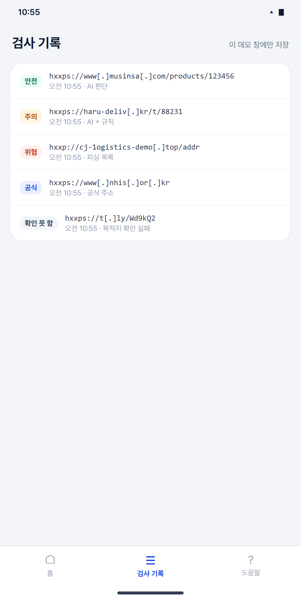
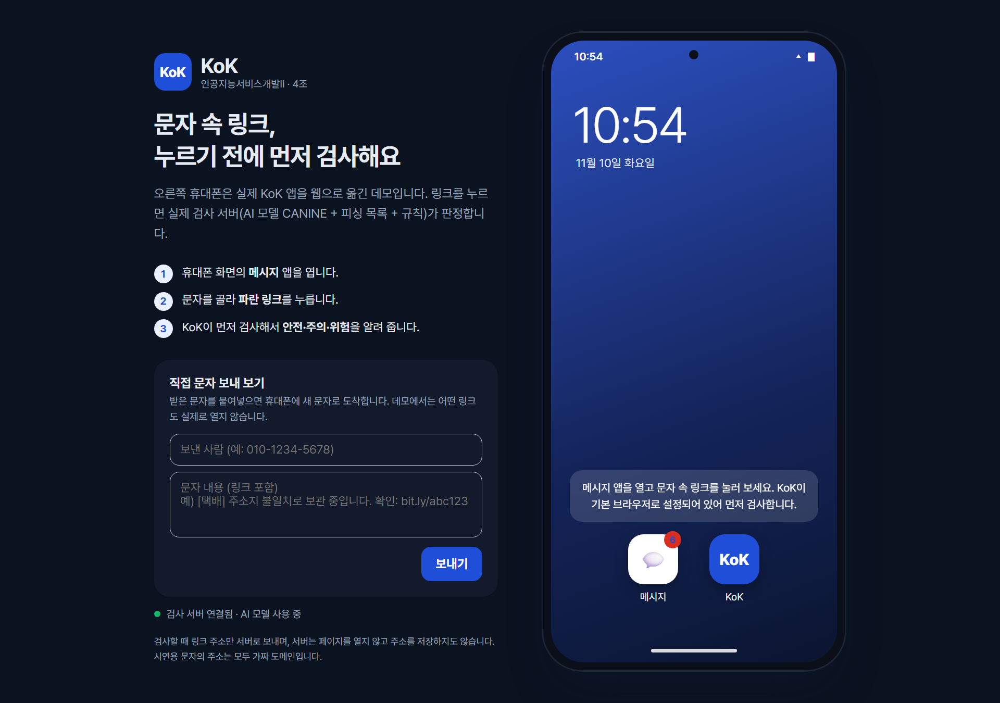
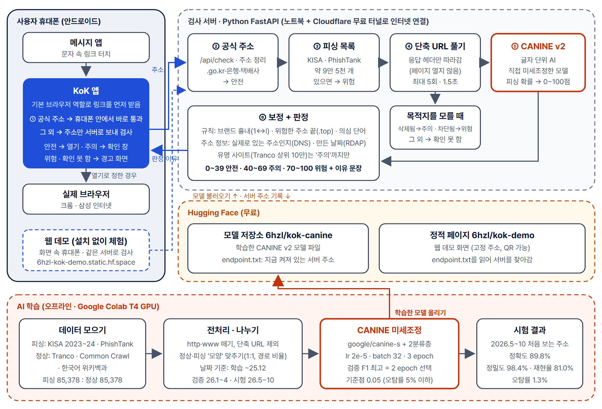

# KoK

**문자 속 링크를 누르는 순간, AI가 먼저 검사하는 스미싱 방지 앱**

인공지능서비스개발II 팀 프로젝트 기획서 · 2026. 11. 10. (11.04판을 학습 결과·배포·웹 데모까지 반영해 고친 판)

| 팀명 | 팀장 | 팀원 |
|---|---|---|
| 4조 | 202404135 이혜리 | 202484006 김서은 |

| 바로 가기 | 주소 |
|---|---|
| 웹 데모 (설치 없이 체험) | https://6hzl-kok-demo.static.hf.space |
| AI 모델 (Hugging Face) | https://huggingface.co/6hzl/kok-canine |
| 소스 코드 (GitHub, 비공개) | https://github.com/hyeri222/smishing-url-explorer |

---

## 요약

### 프로젝트 개요
**KoK**은 문자 속 링크를 **'콕' 누르는 순간** 먼저 검사하는 안드로이드 앱이다. 안전한 링크는 그대로 열고, 애매하면 이유를 보여 주며 열지 묻고, 스미싱이 의심되면 "이 링크는 위험합니다. 여시겠습니까?"라고 경고한다. 사용자는 평소처럼 누르기만 하면 된다. 기존 서비스는 링크를 복사해 따로 확인해야 하거나 이미 신고된 주소만 막는다는 한계에서 출발하였다.

### 판정 흐름
1. 링크 터치 → KoK이 먼저 받음(안드로이드 기본 브라우저 역할)
2. 공식 기관·기업 주소면 휴대폰 안에서 바로 통과
3. 그 외에는 주소만 검사 서버로 보냄 → **피싱 목록** 확인 → **단축 URL 풀기**(페이지는 열지 않음) → **CANINE AI 위험 점수(0~100)** → **규칙·주소 정보로 보정**
4. 안전 → 바로 열기 / 주의 → 이유를 보여 주고 열지 묻기 / 위험 → 빨간 경고 화면 / 목적지를 모름 → 열지 않고 "확인하지 못했습니다"

### 적용 AI 기술
- **CANINE**(Google, `google/canine-s`): 단어로 쪼개지 않고 **글자 하나하나를 읽는** 사전학습 Transformer. 피싱 64,049개 + 정상 64,049개로 직접 미세조정했다.
- **최신 주소 시험 결과**(2026년 5~10월, 학습 때 못 본 주소 26,868개): 정확도 **89.8%**, 정밀도 **98.4%**, 재현율 **81.0%**, 오탐률 **1.3%**
- AI가 약한 부분은 **규칙**(브랜드 흉내, 위험한 주소 끝)과 **주소 정보**(실제로 있는 주소인지, 만든 지 며칠 됐는지)로 보완하는 **하이브리드 구조**

### 개발 및 배포
안드로이드 앱(Kotlin)과 Python FastAPI 검사 서버를 만들었다. 학습은 Google Colab(T4 GPU)에서 했고, 모델은 Hugging Face에 올렸다. 검사 서버는 노트북에서 실행해 Cloudflare 무료 터널로 인터넷에 연결하고, 설치 없이 체험할 수 있는 **웹 데모**를 Hugging Face 정적 페이지로 배포했다. 앱은 APK로 설치한다.

### 기대 효과
따로 확인하지 않아도 링크를 누르는 순간 보호받으므로, 의심 없이 링크를 누르기 쉬운 고령층의 피해를 줄인다. 완성한 앱·웹 데모와 날짜 기준 평가 결과를 **11월 24일 학술제**에 출품한다.

---

## 1. 개발 배경 및 필요성

### 1.1 급증하는 스미싱 피해
스미싱(Smishing)은 문자메시지(SMS)와 피싱(Phishing)의 합성어로, 문자 속 악성 링크로 개인정보·금융정보를 빼내거나 악성 앱을 설치하게 만드는 범죄이다. 한국인터넷진흥원(KISA)이 탐지한 스미싱 문자는 2023년 약 50만 건에서 2024년 약 220만 건으로 늘었고[2][3], 2025년에는 약 4,481만 건으로 2년 만에 90배 가까이 늘었다는 보도가 있다[1]. 2024년 스미싱 중 공공기관 사칭이 59.4%, SNS·기업 사칭이 16.9%였으며[3], 택배 주소 확인, 모바일 청첩장·부고, 과태료·건강보험 안내, 카드 결제 승인 등을 사칭한 문자가 흔하다.

### 1.2 기존 대응 방식의 한계
- **이미 신고된 주소만 막음**: 통신사 차단·백신 앱은 대부분 신고된 주소 목록으로 막는다. 스미싱 조직은 도메인을 계속 새로 만든다. 실제로 KISA 데이터에서 2024년 10~12월 피싱 도메인의 **81.3%는 그 전에 한 번도 나온 적 없는 도메인**이었다(직접 분석).
- **단축 URL로 목적지를 숨김**: KISA 피싱 URL의 **34.6%가 단축 URL**이었다(직접 분석). 사용자는 실제로 어디로 가는지 알 수 없다.
- **확인 과정이 번거로움**: 기존 확인 서비스는 링크를 복사해 따로 보내야 한다. 고령층은 이 과정 없이 그냥 누르게 된다.
- **이유를 알려 주지 않음**: '위험/안전'만 알려 주어 왜 위험한지 알기 어렵다.

### 1.3 개발 동기 및 차별점
팀원들도 택배·청첩장 사칭 문자를 받은 적이 있고, 가족이 "이 링크 눌러도 되냐"고 물어 온 적도 있다. 그래서 '누르기 전에 대신 확인해 주는 AI'를 만들기로 했다.

| 차별점 | 내용 |
|---|---|
| 누르기만 하면 되는 보호 | 복사·붙여넣기 없이, 링크를 누르는 순간 자동으로 검사 |
| 처음 보는 주소도 판단 | 목록에 없는 새 주소는 직접 학습시킨 CANINE이 판단 |
| 이유를 쉬운 말로 | "CJ대한통운 주소를 흉내 낸 가짜 주소 (1ogistics)"처럼 한 줄로 |
| 모를 때는 모른다고 | 목적지를 확인하지 못하면 '안전'이라 하지 않고 열지 않음 |
| 안전한 분석 | 링크 페이지를 열거나 실행하지 않고 주소와 응답 헤더만 확인 |

---

## 2. 개발 목표

### 2.1 최종 목표
문자 속 링크를 누르면 자동으로 검사해 위험할 때만 끼어들고 안전하면 바로 여는 AI 기반 스미싱 방지 안드로이드 앱을 만들고, 학술제에서 실제로 시연한다.

### 2.2 세부 목표와 달성 여부 (11.10 기준)

| 구분 | 목표 | 결과 | 달성 |
|---|---|---|---|
| AI 모델 | 날짜 기준 시험에서 F1 0.90 이상 | v1: 0.918 (2024.10~12 KISA) · v2: 0.889 (2026.5~10 PhishTank) | ✅ / △ |
| AI 모델 | 오탐률 5% 이하 | v1: 1.7% · v2: 1.3% | ✅ |
| AI 모델 | 재현율 0.90 이상 | v1: 0.864 · v2: 0.810 | ❌ (3.4절·10장) |
| 판정 속도 | 서버 판정 2초 이내 | 0.1~0.7초 (인터넷 터널 경유 측정) | ✅ |
| 앱 대기 시간 | 답이 없으면 '확인 못 함' | 4초 안에 답이 없으면 '확인하지 못했습니다' | ✅ |
| 설명 기능 | 위험·주의 판정 시 이유 1줄 이상 | 최대 3줄 표시 | ✅ |
| 서비스 | 링크 가로채기 앱 + 시연 | 앱 완성, 에뮬레이터 확인, APK 배포 | ✅ (실제 휴대폰 시험 ⏳) |
| 확장 | 웹으로 체험 | 웹 데모 배포 | ✅ |

### 2.3 주요 타겟(서비스 대상)
- **고령층과 그 가족**: 판단이 어려운 부모님 세대, 앱을 설치해 드리는 자녀
- **일반 스마트폰 사용자(20~50대)**: 택배·결제 문자 속 링크를 자주 누르는 사용자
- **대학생**: 쇼핑·택배 이용이 많고 장학금 사칭 문자에 노출되기 쉬움

> **페르소나**: 60대 A씨는 "택배 주소지 불일치" 문자를 받고 별생각 없이 링크를 누른다. 자녀가 미리 설치해 둔 KoK이 "이 링크는 위험합니다. CJ대한통운 주소를 흉내 낸 가짜 주소입니다. 여시겠습니까?"라고 묻자 A씨는 [닫기]를 누른다. 평소의 은행·택배 조회 링크는 질문 없이 그대로 열린다.

### 2.4 이 서비스가 잘될 이유
- 스미싱 문자는 나이와 상관없이 거의 모든 사람이 받는다.
- 한 번 설정하면 **평소 행동을 바꿀 필요가 없다.** 확인하는 수고가 없으니 계속 쓰게 된다.
- 위험할 때만 끼어들고, 공식 주소는 휴대폰 안에서 바로 통과해 불편함이 적다.
- **문자 읽기 권한이 필요 없다.** 사용자의 문자 내용을 보지 않고, 누른 링크 주소만 검사한다.

---

## 3. 벤치마킹(또는 관련 연구)

### 3.1 유사 서비스

| 서비스 | 방식 | 한계 | KoK의 개선점 |
|---|---|---|---|
| KISA 보호나라 스미싱 확인 | 카카오톡 채널 등으로 문자·URL을 보내면 확인 | 신고된 주소 위주, 사용자가 직접 보내야 함 | 누르는 순간 자동 검사, 새 주소도 AI가 판단 |
| 경찰청 시티즌코난 | 설치된 악성 앱 탐지 | 설치 후 탐지(사후) | 링크를 누르기 전 단계에서 확인 |
| 통신사·문자 앱 스팸 차단 | 신고 DB·필터로 차단 | 목록 갱신 전 새 주소는 통과 | URL 글자 패턴 학습으로 새 주소 탐지 |
| Google Safe Browsing, VirusTotal | 전 세계 위협 DB 조회 | 해외 중심, 영어 화면, 결과 해석 어려움 | 국내 데이터, 쉬운 한국어 경고와 이유 |

### 3.2 공통점과 차별점
URL의 악성 여부를 확인한다는 목적과, 알려진 피싱 목록을 활용한다는 점은 기존 서비스와 같다. 다만 KoK은 목록을 1차로 쓰고 **목록에 없는 새 주소는 AI가 판단**하며, 사용자가 따로 확인하지 않아도 **누르는 순간 자동으로** 검사한다.

### 3.3 관련 연구
- **Ma et al.(2009), Beyond Blacklists**[4]: URL의 글자·구조 특징만으로 악성 사이트를 높은 정확도로 구분할 수 있음을 보였다. 페이지를 열지 않고 URL만 보는 방식의 근거.
- **Le et al.(2018), URLNet**[5]: URL을 글자 단위로 학습하는 CNN의 높은 성능. 글자 단위 학습의 근거.
- **Pendlebury et al.(2019), TESSERACT**[6]: 학습보다 나중 시점의 데이터로 평가하지 않으면 성능이 과대평가된다. **날짜 기준 분할의 근거.**
- **Clark et al.(2022), CANINE**[7]: 단어로 쪼개지 않고 글자 단위로 읽는 사전학습 Transformer. 띄어쓰기가 없고 한 글자씩 바꿔 위장하는 URL에 맞아 핵심 모델로 선정.
- **부석준·김혜정(2019)**[8]: 문자 단위 CNN과 단어 단위 순환신경망을 결합해 피싱 URL을 분류(정확도 약 0.98). 국내에서도 글자 단위 학습이 효과적임을 보였다.
- **김해수·김미희(2023)**[9]: 단축 URL을 따로 골라 처리(F1 94.86, 평균 5.4초). KoK은 페이지를 열지 않고 리다이렉트 헤더만 따라가 더 빠르고 안전하게 처리한다(0.1~0.7초).
- **김동영·황기성(2024)**[10]: QR코드 속 URL을 특징 35개로 분류(정확도 87.37%)하고 서비스까지 구현한 국내 사례.
- **김영준·이재우(2022)**[11]: URL 주요 특징을 추가해 머신러닝 4종으로 분류(최고 98.5%). 이유 규칙 설계에 참고.
- 스미싱 URL에 사전학습 글자 단위 모델을 쓰고 **날짜 기준으로 평가한** 국내 연구는 찾기 어려웠다.

### 3.4 우리 결과를 기존 연구와 비교할 때 주의할 점
기존 연구의 정확도 98%대는 대부분 **무작위로 나눈** 시험 결과다. KoK도 학습 시기와 가까운 검증셋(2024년 7~9월)에서는 재현율 **97.9%**가 나왔지만, 석 달 뒤 시험셋(10~12월)에서는 **86.4%**로 떨어졌다. 무작위 분할은 이런 '시간이 지나며 생기는 성능 하락'을 가린다. KoK은 서비스에서 실제로 마주칠 **처음 보는 미래 주소** 기준으로 성능을 보고한다.

---

## 4. 결과물 UI

평소에는 화면 없이 동작하고, 주의·위험하거나 확인하지 못한 링크일 때만 창이 뜬다. 아래는 실제 검사 서버와 연결된 **웹 데모** 화면이다(앱과 같은 디자인·문구).

| ① 문자 목록 | ② 위험 경고 | ③ 주의 확인 창 |
|:---:|:---:|:---:|
|  |  |  |
| **④ 확인 못 함** | **⑤ KoK 홈** | **⑥ 검사 기록** |
|  |  |  |

- **① 문자 목록**: 시연용 문자 6개(택배·과태료·청첩장·건강보험·쇼핑몰·지인). 주소는 모두 가짜 도메인이거나 실제 공식 사이트다.
- **② 위험 경고**: "이 링크는 위험합니다. 여시겠습니까?"를 크게 띄우고 위험 점수와 이유를 보여 준다. 큰 버튼은 [닫기(안전)], [그래도 열기]는 작게 둔다. 이미 눌렀을 때의 대처와 118 상담을 안내한다.
- **③ 주의 확인 창**: 바로 열지 않고 아래에서 올라오는 창으로 이유를 보여 준 뒤 [확인하고 열기] / [열지 않기]를 고르게 한다. 정상 링크일 수도 있어 위험 화면보다 가볍게 만들었다.
- **④ 확인 못 함**: 서버가 응답하지 않거나 단축 URL의 목적지를 알아내지 못하면 **열지 않고** 이 화면을 띄운다. [다시 검사]를 누를 수 있다.
- **⑤ KoK 홈**: 보호 상태, 검사한 링크 수, 막은 위험 링크 수, 최근 검사
- **⑥ 검사 기록**: 최근 50개를 휴대폰 안에만 저장한다. 주소는 실수로 눌리지 않게 `hxxp`, `[.]` 형태로 표시한다.

**웹 데모 전체 화면**: 왼쪽에는 소개와 "직접 문자 보내 보기"(받은 문자를 붙여넣으면 화면 속 휴대폰에 새 문자로 도착), 오른쪽에는 휴대폰 화면이 있다. 휴대폰으로 접속하면 틀 없이 앱처럼 꽉 찬 화면으로 보인다. 데모에서는 어떤 링크도 실제로 열지 않고 "브라우저에서 열린 화면(데모)"만 보여 준다.



---

## 5. 주요 기능

| 주요 기능 | 세부 설명 |
|---|---|
| ① 링크 가로채기 | 앱을 안드로이드 **기본 브라우저 역할**(RoleManager)로 등록해, 문자 속 링크를 누르면 KoK이 먼저 주소를 받는다. 판정 후 실제 브라우저(크롬·삼성 인터넷)로 넘긴다. **문자 읽기 권한은 쓰지 않는다.** |
| ② 공식 주소 즉시 통과 | 은행·카드·택배·공공기관 공식 주소(`.go.kr` 전체 포함 39개 규칙)는 휴대폰 안에서 확인해 서버에 보내지 않고 바로 연다. |
| ③ 피싱 목록 | KISA·PhishTank 주소(도메인 39,504개, 주소 55,394개)에 있으면 즉시 '위험'. 텔레그램·구글 설문처럼 널리 쓰이는 사이트는 도메인 전체가 아니라 **신고된 주소 하나만** 막는다. |
| ④ 단축 URL 풀기 | 리다이렉트 응답의 Location 헤더만 따라가 최종 주소를 찾는다(최대 5회·1.5초, 내부망 주소 차단). 페이지 본문은 받지도 실행하지도 않는다. **삭제된 단축 주소(404)는 '주의', 단축 서비스가 차단한 주소는 '위험', 목적지를 모르면 '확인 못 함'.** 목적지 사이트까지 찾은 뒤 시간이 넘으면 찾은 목적지로 판정한다. |
| ⑤ AI 위험 점수 | 목록에 없는 주소는 CANINE이 피싱일 확률을 계산해 0~100점으로 바꾼다. 0~39 안전, 40~69 주의, 70~100 위험(7.5절). |
| ⑥ 규칙 보정 | 브랜드 흉내(편집 거리, `1ogistics`처럼 숫자로 바꾼 글자 포함), 위험한 주소 끝(.top·.xyz 등), IP 주소·특이한 포트, 퓨니코드, 로그인 유도 단어. 브랜드 흉내 + 다른 위험 신호가 겹치면 AI 점수가 낮아도 최소 '위험'(75점). |
| ⑦ 주소 정보 확인 | DNS로 **실제로 있는 주소인지**, RDAP(도메인 등록 기관 공개 정보)로 **만든 지 며칠 됐는지** 본다(0.9초 안에 못 받으면 반영하지 않음). 없는 주소 → '주의', 30일 안에 만든 주소 → '주의', 새 주소 + 위험 신호 → '위험'. |
| ⑧ 유명 사이트 보정 | Tranco 상위 10만 사이트는 AI 점수가 높아도 '주의'까지만 올린다(오탐 방지). 피싱 목록에 있으면 그대로 '위험'. |
| ⑨ 신고·대처 안내 | 위험 화면에서 이미 눌렀을 때의 대처(앱 삭제, 비밀번호 변경, 지급 정지 요청)와 118 상담을 안내한다. |
| ⑩ 검사 기록 | 최근 50개 검사 결과를 휴대폰 안에만 저장. 출처(AI 판단, AI + 규칙, 피싱 목록, 공식 주소, 삭제된 단축 주소 등)를 함께 표시. |
| ⑪ 웹 데모 | 설치 없이 브라우저에서 체험. 화면 속 휴대폰 + 직접 문자 보내기. 주소 뒤에 `#shot=danger`처럼 붙이면 해당 화면이 바로 열린다(발표용). |

### 5.1 실제 판정 예시 (11.10, 실제 서버·v2 모델)

| 주소 | 판정 | 점수 | 판정한 곳 | 이유 |
|---|---|---|---|---|
| `hxxp://cj-1ogistics-demo[.]top/addr` (시연용 가짜) | 🔴 위험 | 100 | 피싱 목록 | 신고된 주소 · CJ대한통운 흉내(1ogistics) · .top |
| `hxxp://nts-refund-check[.]xyz/a` | 🔴 위험 | 98 | AI | 국세청 이름 · .xyz |
| `hxxp://naver-security-alert[.]top/auth` | 🔴 위험 | 99 | AI | 네이버 이름 · .top · 없는 주소 |
| `hxxps://haru-deliv[.]kr/t/88231` | 🟡 주의 | 45 | AI + 규칙 | 인터넷에 없는 주소 |
| `hxxp://bit[.]ly/3xQw9Kd` | 🟡 주의 | 50 | 단축 URL | 삭제됐거나 없는 단축 주소 |
| `hxxps://t[.]ly/Wd9kQ2` | ⚪ 확인 못 함 | – | 단축 URL | 단축 서비스가 확인을 거부 |
| `www.musinsa.com/products/123456` | 🟢 안전 | 3 | AI | – |
| `bit.ly/apple` → `www.apple.com` | 🟢 안전 | 10 | AI | 단축 URL을 풀어 확인 |
| `www.nhis.or.kr` | 🔵 공식 | – | 공식 주소 | – |

---

## 6. 시스템 구조(Architecture)



*그림 1. KoK 시스템 구성도*

| 구성요소 | 설명 | 개발 환경 및 구현 방법 |
|---|---|---|
| 안드로이드 앱 | 링크 가로채기, 공식 주소 확인, 서버 호출, 결과 화면(위험·주의·확인 못 함), 실제 브라우저로 넘기기, 검사 기록, 시연용 문자 화면 | Android Studio, **Kotlin**, 외부 라이브러리 없음. minSdk 29(Android 10), targetSdk 37, Gradle 9.6 / AGP 9.4, 폰트 Pretendard(OFL) |
| 검사 서버 | 주소 정리, 공식·피싱 목록, 단축 URL 풀기, 모델 호출, 규칙·주소 정보 보정, 결과 캐시(1시간) | Python 3.11, **FastAPI**, httpx, tldextract. 자동 시험 31개. 노트북에서 실행 + **Cloudflare 무료 터널**로 인터넷 연결 |
| 서버 주소 찾기 | 터널 주소는 켤 때마다 바뀌므로, 새 주소를 Hugging Face의 `endpoint.txt`에 자동으로 적고 앱·웹 데모가 이를 읽는다 | `run_public.py` 한 번 실행으로 서버·터널·주소 기록까지 처리. **APK를 다시 만들 필요 없음** |
| AI 모델 | URL 글자를 읽고 피싱 확률 계산 | Hugging Face Transformers, PyTorch(CPU 추론, 1건 약 0.1초). 모델 파일은 Hugging Face Hub(`6hzl/kok-canine`) |
| 웹 데모 | 설치 없이 체험 | HTML·CSS·JavaScript 한 파일. Hugging Face 정적 페이지(`6hzl/kok-demo`, 무료·고정 주소) |
| 학습 환경 | 데이터 정리, 미세조정, 평가 | Google Colab T4 GPU, pandas, scikit-learn |

---

## 7. 개발 방법론 (AI 모델)

### 7.1 학습 데이터

| 구분 | 출처 | 기간 | 사용 개수 |
|---|---|---|---|
| 피싱 | 공공데이터포털 '한국인터넷진흥원 피싱사이트 URL' 2023년판·2024년판[12] | 2023.01~2024.12 | 34,167 |
| 피싱 | PhishTank (2026.10.28 내려받음)[13] | ~2026.10 | 51,211 |
| 정상 | Tranco 인기 사이트 순위 (목록 ID `GQ3LK`)[14] | – | 45,503 |
| 정상 | Common Crawl `CC-MAIN-2026-43` (경로 있는 실제 URL)[15] | – | 35,085 |
| 정상 | 한국어 위키백과 외부 링크 (`.kr` 주소)[16] | – | 4,790 |
| 제외 | URLhaus, OpenPhish 무료판 | – | URLhaus는 악성코드 배포 주소라 성격이 다름. OpenPhish 무료판은 300건뿐이고 날짜가 없으며 재배포 금지 |

KISA 원본 159,334건은 주소 정리 후 고유 52,266건이었고, 그중 단축 URL을 뺀 34,167건을 학습에 썼다. KISA는 2024년 12월분이 최신 공개본이다(2026.11 확인).

### 7.2 전처리 — "정답 힌트" 없애기
AI는 피싱의 진짜 특징 대신 **데이터를 모은 방식의 차이**로 맞히는 꼼수를 잘 찾는다. 실제 데이터를 확인하며 다음을 처리했다.

| 문제 | 실제로 발견한 것 | 처리 |
|---|---|---|
| 단축 URL | KISA 피싱의 34.6%(18,099건)가 단축 URL. 글자에 목적지 정보가 없음 | 학습에서 빼고 피싱 목록에만 넣음(61,936건). 서비스에서는 풀어서 판정 |
| 길이·경로 | 처음 모은 정상은 도메인뿐(평균 13자), 피싱은 평균 32자 → "/가 있으면 피싱"으로 외움 | 경로 있는 정상 주소를 모으고, **경로 있는 주소 비율을 피싱과 똑같이** 맞춤 |
| 표기 차이 | 출처마다 `http://`, `www.` 표기가 다름 | 모델 입력에서 스킴과 앞의 `www.`를 뗌(서버도 똑같이) |
| 국가 도메인 | 정상 쪽 .kr이 너무 적거나 많으면 ".kr = 안전/위험"으로 외움 | 정상과 피싱의 .kr 비율을 비슷하게 맞춤 |
| 공식 주소 섞임 | KISA 원본에 `nhis.or.kr` 등 공식 주소가 들어 있었음 | 공식 주소 목록과 겹치면 피싱 목록·학습에서 제거 |
| 유명 사이트 차단 | 피싱 목록에 LinkedIn·텔레그램·구글 설문 등이 도메인째 들어 있었음 | Tranco 상위 10만 도메인은 주소 단위로만 차단 |

```python
def model_text(url):                       # 모델 입력 만들기 (학습·서버 공통)
    s = url.split('://', 1)[-1]            # http:// , https:// 떼기
    return s[4:] if s.startswith('www.') else s
```

### 7.3 날짜 기준 분할
피싱 도메인은 비슷한 것이 한꺼번에 만들어지므로 무작위로 나누면 성능이 부풀려진다[6]. 그래서 **과거로 학습하고 미래로 시험**한다. 정상 URL은 날짜가 없으므로 **도메인 단위로 7:1.5:1.5**로 나눈다(같은 사이트가 학습과 시험에 함께 들어가지 않게).

| 버전 | 학습 | 검증 | 시험 | 학습 피싱 수 |
|---|---|---|---|---|
| v1 | ~2024.06 | 2024.07~09 | 2024.10~12 (KISA 포함) | 41,247 |
| **v2 (현재)** | ~2025.12 (KISA 전체 + PhishTank) | 2026.01~04 | 2026.05~10 | **64,049** |

각 구간은 피싱 : 정상 = 1 : 1이다. v2 시험셋은 피싱 13,434 + 정상 13,434 = 26,868개.

### 7.4 모델 및 학습 방법
- **모델**: `google/canine-s`에 '정상 / 피싱' 2분류층을 붙여 미세조정. URL은 최대 256글자, 글자마다 유니코드 번호 하나로 읽는다(`n4ver` → 110, 52, 118, 101, 114).
- **학습 설정**: 학습률 2e-5, 배치 32, 최대 3 epoch, warmup 6%, weight decay 0.01, fp16, 손실 함수는 교차 엔트로피. Colab T4 GPU.
- **최적 모델 선택**: epoch마다 검증셋으로 채점해 **F1이 가장 높은 회차**를 최종 모델로 쓰고, 점수가 오르지 않으면 조기 종료한다. epoch마다 저장해 Colab이 끊겨도 이어서 학습한다.

```python
model = CanineForSequenceClassification.from_pretrained(
    'google/canine-s', num_labels=2, id2label={0: 'normal', 1: 'phishing'})
TrainingArguments(num_train_epochs=3, learning_rate=2e-5, per_device_train_batch_size=32,
                  warmup_ratio=0.06, weight_decay=0.01, fp16=True, eval_strategy='epoch',
                  load_best_model_at_end=True, metric_for_best_model='f1')
```

**학습 과정 (손실)**

| epoch | v1 학습 손실 | v1 검증 손실 | v1 검증 F1 | v2 학습 손실 | v2 검증 손실 | v2 검증 F1 |
|---|---|---|---|---|---|---|
| 시작 | 0.689 | – | – | 0.687 | – | – |
| 1 | 0.072 | 0.100 | 0.976 | 0.062 | 0.159 | 0.957 |
| **2 ⭐** | 0.043 | **0.084** | **0.979** | 0.052 | **0.136** | **0.964** |
| 3 | 0.032 | 0.095 ↑ | 0.978 | 0.043 | 0.169 ↑ | 0.962 |

두 버전 모두 3 epoch에서 학습 손실은 계속 줄었지만 검증 손실이 다시 올랐다(**과적합 신호**). 그래서 **2 epoch 모델**을 최종으로 골랐다. 10 epoch처럼 더 오래 학습하지 않은 이유이기도 하다.

### 7.5 경고 기준점과 점수
위험한 링크를 놓치는 것(미탐)이 더 치명적이므로, **검증셋에서 오탐률 5% 이하를 지키면서 재현율이 가장 높은 기준점**을 골랐다. 결과는 확률 **0.05**였다. 이를 화면 점수 구간에 맞춰 바꾼다.

| 피싱 확률 | 점수 | 판정 |
|---|---|---|
| 0.05 미만 | 0~39 | 🟢 안전 |
| 0.05 ~ 0.5 | 40~69 | 🟡 주의 |
| 0.5 이상 | 70~100 | 🔴 위험 |

### 7.6 평가 결과

**v1 (2024.10~12 시험, 한국 KISA 포함, 기준점 0.05)**

| 정확도 | 정밀도 | 재현율 | F1 | 오탐률 | AUC |
|---|---|---|---|---|---|
| 92.3% | 98.0% | 86.4% | 0.918 | 1.7% | 0.975 |

**v1 vs v2 (같은 시험지: 2026.05~10, 26,868개, 기준점 0.05)**

| 지표 | v1 | **v2** | 변화 |
|---|---|---|---|
| 정확도 | 89.3% | **89.8%** | +0.5%p |
| 정밀도 | 97.9% | **98.4%** | +0.5%p |
| 재현율 | 80.4% | **81.0%** | +0.6%p |
| F1 | 0.883 | **0.889** | +0.006 |
| 오탐률 | 1.70% | **1.32%** | 약 22% 감소 |
| AUC | 0.953 | **0.956** | +0.003 |
| 놓친 피싱 / 잘못 막은 정상 | 2,634 / 228 | **2,552 / 178** | |

**해석**
- **시간이 지날수록 성능이 떨어진다.** v1 재현율은 3개월 뒤 86.4%, 1년 반 뒤 80.4%였다. 피싱 수법과 도메인이 계속 바뀌기 때문이다.
- **최신 데이터로 다시 학습하면 나아진다.** v2는 모든 지표가 조금씩 좋아졌고, 특히 오탐이 22% 줄었다. 시연 주소 중 브랜드 사칭(네이버·우체국)을 v1은 규칙이 대신 잡았지만 v2는 **AI가 스스로 97~99점**으로 잡았다.
- 그래서 AI 하나에 의존하지 않고 **피싱 목록 + 규칙 + 주소 정보**를 함께 쓰는 하이브리드 구조로 만들었다.

### 7.7 보안·개인정보 설계
- 서버는 링크 페이지의 본문을 받거나 실행하지 않고 **응답 헤더만** 본다. 요청 횟수·시간을 제한하고 내부망(사설 IP) 주소로는 요청하지 않는다.
- 공식 주소는 휴대폰 안에서 처리해 서버로 보내지 않는다. 서버는 판정한 주소를 저장하지 않는다(접속 기록도 남기지 않음).
- 앱은 **문자 읽기 권한을 쓰지 않는다.** 사용자가 누른 링크 주소만 검사한다.
- 앱의 통신은 HTTPS만 허용한다(개발용 로컬 서버만 예외). 서버 주소 파일(`endpoint.txt`)도 `https://` 주소만 받아들인다.
- 수집한 피싱 URL은 브라우저로 열지 않고, 문서·발표에는 `hxxp://example[.]top`처럼 눌리지 않게 적는다. 시연은 실제 피싱이 아닌 **가짜 시연 주소**로 한다. 웹 데모는 어떤 링크도 실제로 열지 않는다.
- 피싱 원본 데이터는 GitHub에 올리지 않고, 데이터를 다시 만드는 코드만 올린다.

---

## 8. 팀원 역할분담(R&R)

| 팀원 | 역할 및 할 일 |
|---|---|
| **이혜리 (팀장)**<br>앱·규칙 담당 | • 안드로이드 앱(링크 가로채기, 결과 화면, 홈·기록 화면)<br>• 공식 주소 목록, 이유 규칙<br>• 실제 휴대폰 시험, 사용성 테스트, 배포<br>• 일정·GitHub 관리<br>• 발표: 문제 정의, 앱 시연, 화면·규칙 |
| **김서은 (팀원)**<br>모델·서버 담당 | • 데이터 수집·정리, 날짜 기준 분할<br>• CANINE 미세조정·평가(v1·v2)<br>• 검사 서버, 배포<br>• 학술제 포스터용 결과 정리<br>• 발표: AI 모델, 데이터, 평가 결과 |
| **공통** | 주 1회 회의, 서로 코드 리뷰, 오탐 사례 분석, 통합 테스트(시연용 문자), 웹 데모·시연 영상, 발표 자료 |

---

## 9. 일정(소요예산, 요청사항 포함)

### 9.1 개발 일정 (✅ 완료, ⏳ 진행 중)

| 주차 | Sprint | 주요 작업 | 상태 |
|---|---|---|---|
| 6주 (10.7) | SP1 | 아이디어 발표, 주제 확정 | ✅ |
| 7주 (10.14) | SP1 | 기획서, 데이터 확보 가능 여부·이용 조건 확인 | ✅ |
| 8주 (10.21) | SP1 | 데이터 정리, 날짜 기준 분할 | ✅ |
| 9주 (10.28) | SP2 | 검사 서버, 학습 코드, 앱 시제품 | ✅ |
| 10주 (11.4) | SP2 | CANINE v1 학습, 기준점 결정, 서비스명 KoK, 앱 디자인 적용, 규칙·유명 사이트 보정 | ✅ |
| 11주 (11.11) | SP2 | 주소 정보 확인(DNS·RDAP), **v2 재학습**, 모델 공개, 서버 인터넷 연결, **웹 데모 배포**, 단축 URL 판정 개선 | ✅ |
| 11주 (11.11) | SP2 | 실제 휴대폰 시험(삼성 메시지·구글 메시지), 시연 영상 촬영, 발표 자료 | ⏳ |
| 12주 (11.18) | SP2 | SP2 발표·데모, 11.21까지 안정화, **11.24 학술제** | |
| 13주 (11.25) | SP3 | 학술제 피드백 반영, 오판 신고 | |
| 14주 (12.2) | SP3 | 알림 읽기로 문자 도착 시 미리 검사(선택), 상시 서버 | |
| 15주 (12.9) | SP3 | 최종 배포, SP3 발표 | |

### 9.2 Sprint별 프로토타입 기능
- **SP1 (8주)**: 학습 데이터셋 완성(피싱·정상 1:1, 날짜 분할, 정답 힌트 제거) ✅
- **SP2 (12주)**: 링크 터치 → 자동 검사 → 결과 화면, 실제 서버 연결, 웹 데모, 학술제 시연 ✅ (실제 휴대폰 시험 ⏳)
- **SP3 (15주)**: 오판 신고, 문자 도착 시 미리 검사, 상시 서버를 포함한 최종 서비스

### 9.3 소요 예산 및 요청사항

| 항목 | 비용 | 비고 |
|---|---|---|
| 학습(Google Colab T4) | 0원 | 무료 GPU. epoch마다 저장해 끊겨도 이어서 학습 |
| 모델 저장·웹 데모(Hugging Face) | 0원 | 모델 저장소, 정적 페이지 무료 |
| 검사 서버 | 0원 | 노트북 + Cloudflare 무료 터널(노트북이 켜져 있을 때만 동작) |
| 코드(GitHub) | 0원 | 비공개 저장소 |
| 데이터 | 0원 | 모두 공개 데이터 |
| (선택) 상시 서버 | 월 9달러 | Hugging Face PRO(Docker 서버). 또는 Azure for Students 무료 크레딧 |
| (선택) Play 스토어 개발자 등록 | 1회 25달러 | 일반 사용자 배포 시. 시연은 APK로 충분 |

**학교 지원 요청**
1. 학술제 기간 상시 서버: Hugging Face PRO 1~2개월(약 1만 3천 원/월). 노트북이 꺼져도 앱·웹 데모가 동작하게 한다.
2. 학술제 포스터 인쇄, 부스용 QR코드 출력

---

## 10. 개발 시 문제점(위험요소) 및 극복 방안

| 위험요소 | 극복 방안 |
|---|---|
| **새 수법에 약해짐**(재현율 86% → 81%) | 최신 데이터로 재학습(v2에서 오탐 22% 감소), 피싱 목록 정기 갱신, 규칙·주소 정보로 보완 |
| 무료 Hugging Face가 Docker 서버를 더 이상 지원하지 않음(11.10 확인) | 노트북 + 무료 터널 + `endpoint.txt`로 해결. 학술제 기간엔 학교 지원으로 상시 서버 검토 |
| 노트북이 꺼지면 서버도 꺼짐 | 앱·웹 데모는 '확인하지 못했습니다'로 안전하게 처리(열지 않음). 학술제 당일 노트북 전원 연결·절전 해제 |
| 서버가 늦으면 검사 없이 열릴 위험 | 그냥 열지 않고 '확인하지 못했습니다'. 서버 시작 시 모델을 미리 한 번 돌려 첫 검사도 빠르게(0.3초) |
| 단축 URL은 글자만으로 판단 불가 | 서버에서 풀어서 최종 주소로 판정. 삭제된 주소·차단된 주소·모르는 주소를 구분 |
| 모델이 데이터 수집 방식의 차이로 맞힘 | 경로 비율·표기·.kr 비율을 피싱과 정상에서 맞춤(7.2) |
| 성능 부풀림 | 날짜 기준 분할, 정상은 도메인 단위 분할 |
| 오탐(정상을 위험으로) | 공식 주소 즉시 통과, 유명 사이트는 '주의'까지만, 주의는 열지 묻기만 함. 예: `open.spotify.com/user/긴 무작위 문자열`은 AI가 69점(주의)으로 봄 |
| **카카오톡 링크는 검사 불가** | 카카오톡은 자체 브라우저로 링크를 열어 기본 브라우저를 거치지 않는다. 웹 데모에 붙여넣어 검사, SP3에서 알림 읽기 방식 검토 |
| iOS 미지원 | 웹 데모는 아이폰에서도 동작. 앱은 향후 과제 |
| 출처 모를 APK 설치 권유의 모순 | 시연은 팀원 휴대폰에 미리 설치. 일반 배포는 Play 스토어 |
| 2인 팀 일정 | 핵심(앱·서버·모델·웹 데모)을 11.10까지 먼저 완성, 나머지는 SP3 |

---

## 11. 필수사항 충족 계획

| 필수사항 | 충족 방법 | 상태 |
|---|---|---|
| 인공지능 기술 포함 | 사전학습 Transformer **CANINE을 피싱/정상 URL로 직접 미세조정**한 분류 모델(v1·v2) | ✅ |
| 웹 또는 앱 개발 | 안드로이드 앱(Kotlin) + 웹 데모 | ✅ |
| 배포 | 모델: Hugging Face Hub · 웹 데모: Hugging Face 정적 페이지 · 서버: 노트북 + 무료 터널 · 앱: APK | ✅ |
| 학술제 출품 또는 논문 제출 | 동작하는 앱·웹 데모 + 날짜 기준 성능으로 11월 24일 학술제 출품 | ⏳ |
| 외부 자원 출처 표시 | 데이터·모델·오픈소스·참고 문헌을 13장에 명시 | ✅ |

---

## 12. 기대 효과 및 활용 분야

### 12.1 기대 효과
- **개인 피해 예방**: 누르는 순간 자동 검사로 개인정보 유출, 악성 앱 설치, 금전 피해를 줄인다.
- **디지털 취약계층 보호**: 따로 확인할 필요가 없어 고령층도 그대로 보호받는다.
- **새 위협 대응**: 목록에 오르기 전의 새 주소도 AI와 주소 정보로 판단한다.
- **보안 인식 향상**: "왜 위험한지"를 보여 주어 스스로 구별하는 힘을 기른다.

### 12.2 활용 분야
- 문자 도착 알림을 읽어 누르기 전에 미리 경고(알림 접근 권한, 카카오톡 알림 포함)
- 보호자 알림: 부모님 휴대폰에서 위험 링크를 누르면 자녀에게 알림
- 쇼핑몰·커뮤니티 게시판 링크 자동 검사 API, PC 브라우저 확장 프로그램
- 실제 사례와 판정 이유를 활용한 보안 교육

---

## 13. 참고 자료 및 출처

**통계·기사**
1. 서울경제(2026.6.26), https://www.sedaily.com/article/20060559
2. 뉴스토마토, https://newstomato.com/ReadNews.aspx?no=1225217
3. 뉴스토마토, https://newstomato.com/ReadNews.aspx?no=1254078

**논문**

4. J. Ma, L. K. Saul, S. Savage, G. M. Voelker, "Beyond Blacklists: Learning to Detect Malicious Web Sites from Suspicious URLs," KDD, 2009.
5. H. Le, Q. Pham, D. Sahoo, S. C. H. Hoi, "URLNet: Learning a URL Representation with Deep Learning for Malicious URL Detection," arXiv:1802.03162, 2018.
6. F. Pendlebury et al., "TESSERACT: Eliminating Experimental Bias in Malware Classification across Space and Time," USENIX Security, 2019.
7. J. H. Clark, D. Garrette, I. Turc, J. Wieting, "CANINE: Pre-training an Efficient Tokenization-Free Encoder for Language Representation," TACL, 2022.
8. 부석준, 김혜정, "피싱 웹사이트 URL의 수준별 특징 모델링을 위한 컨볼루션 신경망과 게이트 순환신경망의 퓨전 신경망," 정보보호학회지, 29(3), 2019.
9. 김해수, 김미희, "GRU 기반 단축 URL 판별 기법을 적용한 하이브리드 피싱 사이트 탐지 시스템," 전기전자학회논문지, 27(3), 2023.
10. 김동영, 황기성, "큐싱 공격 탐지를 위한 AutoML 머신러닝 기반 악성 URL 분류 기술 연구 및 서비스 구현," 스마트미디어저널, 13(6), 2024.
11. 김영준, 이재우, "URL 주요특징을 고려한 악성 URL 머신러닝 탐지모델 개발," 한국정보통신학회논문지, 26(12), 2022.

**데이터**

12. 공공데이터포털, 한국인터넷진흥원_피싱사이트 URL_20231231 / 한국인터넷진흥원_피싱사이트_20241231, https://www.data.go.kr/data/15109780/fileData.do , https://www.data.go.kr/data/15143094/fileData.do
13. PhishTank (Cisco Talos), https://phishtank.org
14. V. Le Pochat et al., "Tranco: A Research-Oriented Top Sites Ranking Hardened Against Manipulation," NDSS, 2019. https://tranco-list.eu (목록 ID GQ3LK)
15. Common Crawl, CC-MAIN-2026-43 cluster index, https://commoncrawl.org
16. 한국어 위키백과 외부 링크 덤프(CC BY-SA), https://dumps.wikimedia.org/kowiki/
17. IANA RDAP 서버 목록, https://data.iana.org/rdap/dns.json

**모델·오픈소스·서비스**: CANINE(google/canine-s, Apache 2.0), Hugging Face Transformers·Hub·Spaces, PyTorch, FastAPI, Uvicorn, httpx, tldextract, scikit-learn, pandas, Android SDK(Kotlin), Pretendard 폰트(SIL OFL 1.1), Cloudflare Tunnel, Google Colab

---

## 부록 A. 구현 현황 (11.10 기준)

| 항목 | 상태 | 확인 내용 |
|---|---|---|
| 검사 서버 | ✅ | 자동 시험 31개 통과. 인터넷 터널 경유 판정 0.1~0.7초 |
| 학습 데이터 | ✅ | v1·v2 데이터셋, 피싱 목록(도메인 39,504 · 주소 55,394), 유명 사이트 99,954 |
| AI 모델 | ✅ | v1(10.28 학습), v2(11.09 재학습) 완료. v2를 서버에 적용, Hugging Face에 공개 |
| 안드로이드 앱 | ✅ | 빌드·에뮬레이터 확인(인터넷 서버 경유). `dist/KoK-demo.apk` |
| 웹 데모 | ✅ | https://6hzl-kok-demo.static.hf.space 에서 시연 문자 6개 + 직접 입력 모두 확인 |
| 실제 휴대폰 시험 | ⏳ | 삼성 메시지·구글 메시지에서 링크 터치 → KoK 검사 확인 필요 |
| 상시 서버 | ⏳ | 학교 지원 여부에 따라 Hugging Face PRO 또는 Azure |
| 오판 신고, 문자 도착 시 미리 검사 | SP3 | – |

## 부록 B. 직접 실행하는 방법

검사 서버 켜기(인터넷 연결 + 주소 자동 기록, 끄기는 Ctrl+C):
```
cd server
.venv\Scripts\python run_public.py
```

데이터 다시 만들기 / 모델 다시 학습(Colab):
```
python training/prepare_data.py --v2
!python $D/data_v2/train_canine.py --data $D/data_v2 --out $D/out_v2 --epochs 3
```

웹 데모 바로 가기(발표용): 주소 뒤에 `#shot=` + `inbox`, `danger`, `caution`, `unknown`, `kok`, `history` 중 하나를 붙인다.
예) https://6hzl-kok-demo.static.hf.space/#shot=danger
